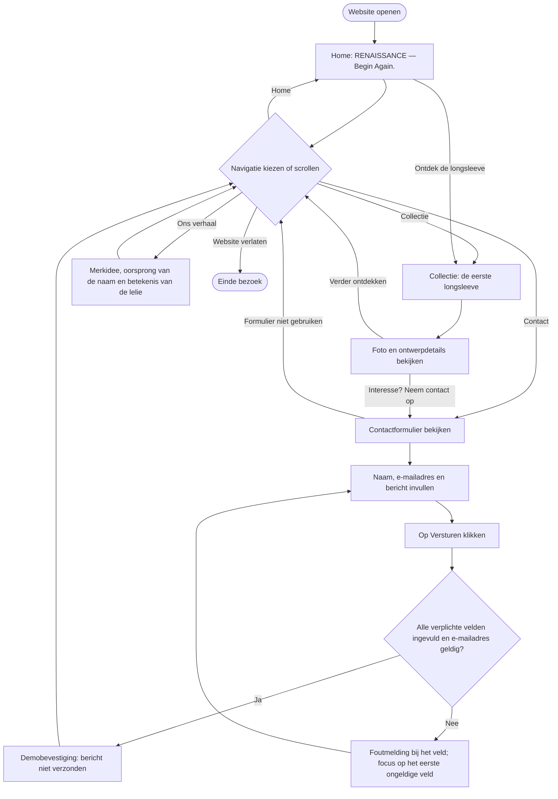

# RENAISSANCE — Flowchart

De bezoeker kan zowel via de navigatie als door te scrollen tussen de vier secties bewegen. De controles onder Contact horen bij de latere JavaScript-uitwerking.

[Terug naar het ontwerpoverzicht](ontwerp.md)
