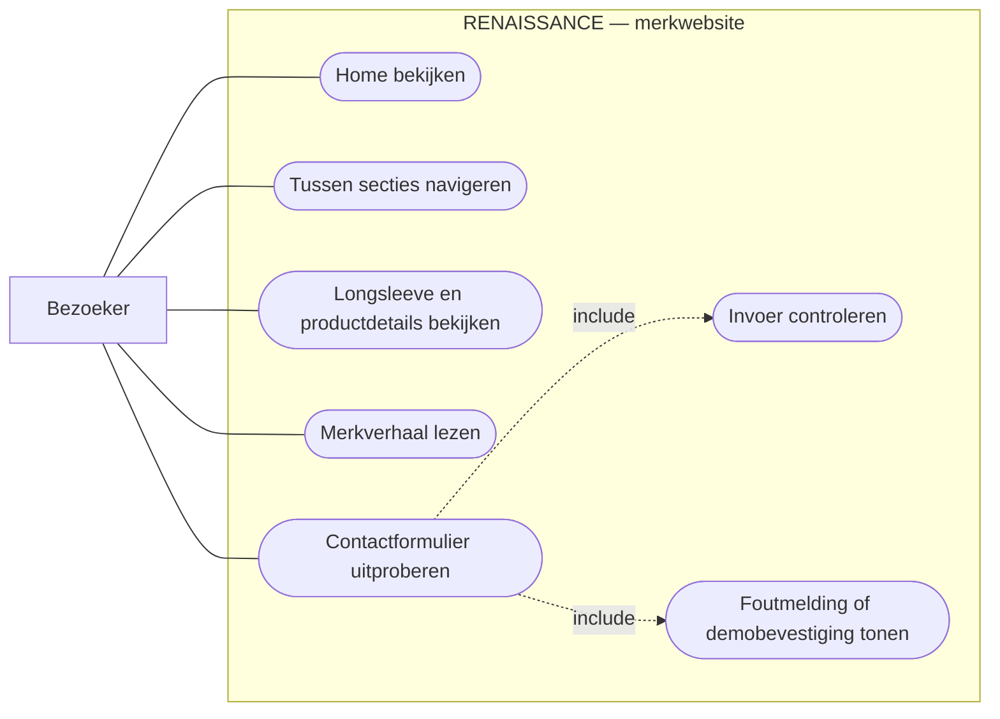

# RENAISSANCE — Usecasediagram

**Actor:** bezoeker. Het kader is de grens van de RENAISSANCE-website. Doorgetrokken lijnen verbinden de bezoeker met de beschikbare handelingen. De gestippelde relaties met `include` geven verplichte onderdelen van het uitproberen van het formulier aan. De bevestiging verschijnt alleen bij geldige invoer.

Mermaid ondersteunt geen afzonderlijk UML-usecasediagram. Daarom gebruikt deze benadering een flowchart met afgeronde usecases en een systeemgrens.

[Terug naar het ontwerpoverzicht](ontwerp.md)
