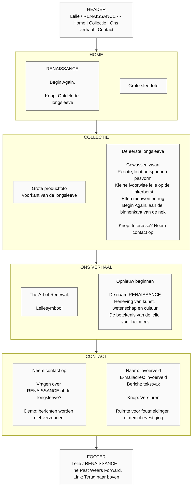

# RENAISSANCE — Wireframe — desktop

Dit is een schematische indeling, geen definitieve vormgeving. De pijlen tonen de leesvolgorde op dezelfde pagina. Tekst en beeld staan naast elkaar waar de schermbreedte dat toelaat.

[Terug naar het ontwerpoverzicht](ontwerp.md)
