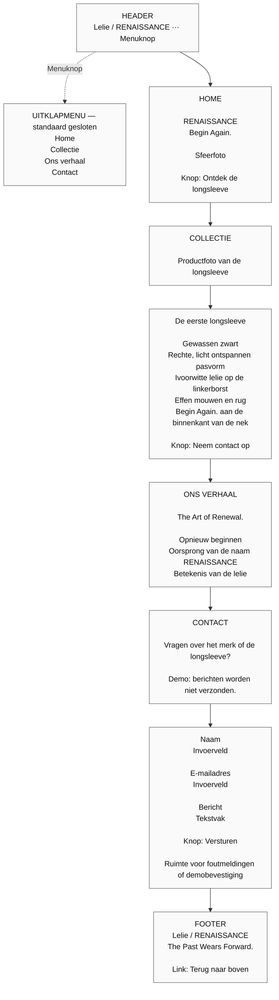

# RENAISSANCE — Wireframe — mobiel

Op mobiel staan alle onderdelen onder elkaar. De menuknop opent de vier navigatielinks. Na het kiezen van een link sluit het menu en gaat de bezoeker naar de bijbehorende sectie.

[Terug naar het ontwerpoverzicht](ontwerp.md)
